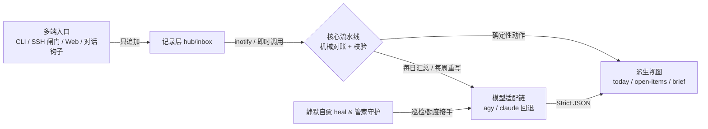

# hushAi-agent

> **hushAi-agent** 是一个面向个人与轻量 VPS 部署的开源个人 AI 记忆与常驻管家框架，通过以本地纯文本 Markdown 为唯一事实源与厂商中立的双模型流水线，解决跨端对话记忆割裂、AI 厂商锁定及服务运维繁琐的核心痛点。

[](https://github.com/danielwu37/hushai-agent/releases)
[](./LICENSE)
[](./pyproject.toml)

---

## 1. 项目目标 (Why & Goals)

在长期使用 AI 助手的个人场景中，传统做法通常面临记忆锁死在单一云厂商、不同设备间状态不同步、模型额度耗尽后对话中断、以及需要频繁手工维护提示词和数据库等痛点。`hushAi-agent` 提供了一套 **纯文本、零外部依赖、低维护成本** 的个人底座方案：

- **核心目标**：实现「多端只追加记录 → 定时/即时机械与模型汇总 → 多入口可读可勾」的个人记忆闭环，让不同 AI 工具安全协作读写同一份属于你自己的记忆库（`vault`）。
- **适用边界 (In Scope)**：个人服务器（2 GB 内存即可）上的持久化记忆管理、日常待办筛选与晨间简报、多 AI CLI 切换与额度兜底、SSH 受控多端读写与静默自愈。
- **非目标 (Non-Goals)**：本项目不自建重型数据库/向量库/消息队列，不替代上游 AI CLI 本身的客户端界面，也不绑定特定云端域名或公网反代方案。

---

## 2. 核心功能 (Features)

- **记忆三层与对账闭环**：严格区分「约定层（画像与规则）」「记录层（各端只追加收件）」与「派生层（开放项、近况、今日待办、洞察与日报）」；确定性操作（完成/推迟/放弃/更正）毫秒级纯代码落盘，派生视图可随时由记录层重算。
- **多 AI 引擎与常驻管家切换**：内置 `claude` 与 `agy`（Antigravity CLI）适配及 `fake` 离线测试桩，后台流水线支持 `light`/`heavy` 回退链与每日预算护栏；常驻 `tmux` 管家支持一条命令在模型间切换，检测到 Claude 额度耗尽时自动由 `agy` 接手并置顶提醒。
- **多端受控接入与简报界面**：提供只读与受限写入的 SSH 强制命令闸门（含透明路径兼容）、事件驱动跨端只读路由、单屏晨间简报（Markdown / HTML）以及仅监听本机回环、凭令牌认证的可点选待办网页。
- **静默自愈与极简生命周期**：内置 8 项定时自愈巡检（磁盘、挂载探针、监听单元、定时补跑、管家在线与额度接手），所有系统日志只写运行账本不污染人类视图；支持一键安装向导、完整导出打包与无损模板升级。

---

## 3. 实现路径与架构 (How It Works)

### 核心数据流



1. **只追加采集**：手机、桌面或常驻管家会话结束时，经路径护栏或 SSH 闸门将五段式事实行追加到当天的收件文件（`hub/inbox/YYYY-MM-DD-<端>.md`）。
2. **机械优先对账**：收件落盘后立即触发轻量事件处理，优先用纯代码消化办完、推迟、放弃、决定、教训与候选记忆，不消耗模型额度。
3. **有限模型判断与落盘**：每日定时任务在隔离空目录下调用无工具问答模型提取新增事项与近况，经代码严格校验字段与 `line_id` 后原子覆写派生文件并本地 Git 提交。

### 技术栈与选型理由

| 组件 | 选型 | 理由 |
| :--- | :--- | :--- |
| 运行时与依赖 | **Python 3.10+（纯标准库）** | 零第三方包依赖，避免版本冲突与漫长构建，极简 VPS 开箱即跑 |
| 存储格式 | **Markdown + JSONL + 本地 Git** | 人类可读、不锁厂商、可审计可回滚，无需维护数据库守护进程 |
| 调度与常驻 | **systemd + tmux** | 系统原生生命周期管理与断线重连，进程峰值 1 GB 内存以内即可稳定运行 |
| 远端同步 | **rclone copy（非挂载点）** | 按文件归属单向同步，规避网盘 FUSE 挂载卡死拖垮整机进程 |

### 目录结构（顶层职责）

```text
.
├── bin/                   # 免 pip 直启命令行包装与 SSH 强制命令隔离入口
├── docs/                  # 架构规范、多端接入协议、使用者与管理员手册
├── examples/              # 虚构示例记忆库（可直接用于本地验证与体验）
├── src/hushai_agent/      # 核心包：CLI、记忆库引擎、适配层、闸门、自愈与模板
├── tests/                 # 离线自动化单元测试套件（基于 fake 适配器）
├── tools/                 # 隐私扫描等辅助研发工具
├── pyproject.toml         # 标准 Python 包元数据与命令入口定义
└── CHANGELOG.md           # 版本变更记录
```

---

## 4. 快速上手 (Quick Start)

**前置依赖**：`Ubuntu 22.04+ / Debian 12+ / Linux VPS`（内存建议 ≥ 2 GB）、`Python 3.10+`、`git`、`tmux`、`systemd`，以及至少一个已登录认证的终端 AI 工具（用于后台汇总或常驻管家）。

### 方式一：AI 命令行一键自动安装（推荐）

如果你已在 VPS 终端装好任意编程 Agent CLI（如 **Claude Code**、**Codex**、**DeepSeek CLI**、**Antigravity (`agy`)**、**Gemini CLI** 等），直接进入会话发送下面这段话，即可让 AI 全自动完成下载、配置、服务注册与体检：

```text
请帮我把 https://github.com/danielwu37/hushai-agent.git 自动安装并部署到当前这台 VPS 上，要求如下：
1. 检查当前系统（Python 3.10+、git、tmux、systemd）以及本机已安装并登录的 AI CLI（claude / agy 等）。
2. 将仓库克隆到 ~/hushai-agent（若已存在则拉取最新代码）。
3. 优先尝试在独立 venv 安装或将 ~/hushai-agent/bin/hushai 软链到 ~/.local/bin/hushai（确保 PATH 可直接执行 hushai，不要破坏系统全局 Python 环境）。
4. 使用当前机器时区、我的实际目录 ~/hushai-vault，运行 `hushai install wizard --instance my --vault ~/hushai-vault` 完成实例初始化、单元生成与端接入包渲染（根据本机实际可用的 AI CLI 自动调整 [steward] 与 [adapters]）。
5. 核对并安装启用 ~/.config/hushai/my/units/ 下的 systemd 单元（daemon-reload 并 enable --now watch.path、heal.timer、digest.timer、weekly.timer、steward.service）。
6. 运行 `hushai validate ~/hushai-vault`、`hushai doctor --instance my` 与 `hushai steward status --instance my`，只把真实执行的命令输出和最终使用入口汇报给我。
```

### 方式二：手动三步部署到 VPS

```bash
# 1. 克隆仓库并配置免依赖命令行入口（也可用 venv + pip install --no-build-isolation --no-deps -e .）
git clone https://github.com/danielwu37/hushai-agent.git ~/hushai-agent
mkdir -p ~/.local/bin && ln -sf ~/hushai-agent/bin/hushai ~/.local/bin/hushai
hushai version

# 2. 一站式向导初始化实例、记忆库与 systemd 单元（默认在 ~/hushai-vault）
hushai install wizard --instance my --vault ~/hushai-vault --timezone Asia/Shanghai --lang zh --steward agy

# 3. 验证通过后，按向导输出启用 systemd 后台服务
sudo cp ~/.config/hushai/my/units/hushai-my-*.* /etc/systemd/system/
sudo systemctl daemon-reload
sudo systemctl enable --now hushai-my-watch.path hushai-my-heal.timer hushai-my-digest.timer hushai-my-weekly.timer hushai-my-steward.service
```

> **仅本地零配置体验示例库**：`hushai validate ~/hushai-agent/examples/vault-demo`；运行离线全量单测：`PYTHONPATH=~/hushai-agent/src python3 -m unittest discover -s ~/hushai-agent/tests`。

---

## 5. 核心配置与日常使用 (Configuration & Usage)

### 核心配置契约

所有实例运行参数统一存储在 `~/.config/hushai/<实例名>/config.ini`（可用 `hushai --help` 查看全部子命令）。以下仅列出最关键的 5 个配置项：

| 配置节与键 | 必填 | 默认值 | 说明 |
| :--- | :--- | :--- | :--- |
| `[instance] vault` | 是 | 无 | 记忆库绝对路径（必须在本地磁盘，勿放网盘挂载点） |
| `[instance] timezone` | 是 | `Asia/Shanghai` | 实例所属 IANA 时区，决定每日汇总与收件归档日期 |
| `[steward] backend` | 否 | `agy` | 常驻管家使用的模型后端（`claude` 或 `agy`） |
| `[jobs] digest` / `weekly` | 否 | `agy:light, claude:light` | 任务模型与自动回退链 |
| `[privacy] local_only` | 否 | `domains/health` | 永不出本机的目录，同步与模型提示词硬性跳过 |

### 典型日常用法

```bash
# 查看或一条命令切换常驻管家模型（claude / agy）
hushai steward status --instance my
hushai steward use claude --instance my

# 查看今日待办 / 生成并查看晨间简报 / 启动本机待办点选页面（127.0.0.1:8765）
hushai today --instance my
hushai brief --instance my --md
hushai serve --instance my --port 8765
```

- 日常对话与网页操作说明：[使用者手册](./docs/user-guide.md)
- 多实例隔离、反向代理、同步与自愈运维：[安装与维护手册](./docs/admin-guide.md)
- 多端接入与 SSH 文本闸门协议：[多端接入指南](./docs/doors.md)
- 系统设计规范与原理：[架构设计文档](./docs/design.md)

---

## 6. 功能更新与演进路线 (Roadmap & Updates)

### 演进路线 (Roadmap)
- [x] **Phase 1 — 核心记忆引擎**：纯文本规范、路径护栏、机械与模型双阶段汇总、7 天离线回放验证
- [x] **Phase 2 — 多端闭环与运维自愈**：SSH 闸门、跨端路由、晨间简报、一键安装向导与 8 项静默自愈（含额度接手）
- [ ] **Phase 3 — 生态扩展**：更多内置模型 CLI 适配模板与开箱即用的轻量端同步方案

### 功能更新记录 (Changelog)
本项目的版本迭代、功能新增与修复记录均随发布自动聚合，不在 README 中手工堆砌：
- 查看每个版本的详细发布说明：[GitHub Releases](https://github.com/danielwu37/hushai-agent/releases)
- 查看历史变更摘要：[CHANGELOG.md](./CHANGELOG.md)

---

## 7. 贡献与开源协议 (Contributing & License)

欢迎提交 Issue 或 Pull Request！提交代码前请先在本地跑通 `unittest`，并遵循 `feat:` / `fix:` / `docs:` 语义化提交规范，以便配合 GitHub Releases 自动生成更新说明。

本项目基于 [MIT License](./LICENSE) 开源。
